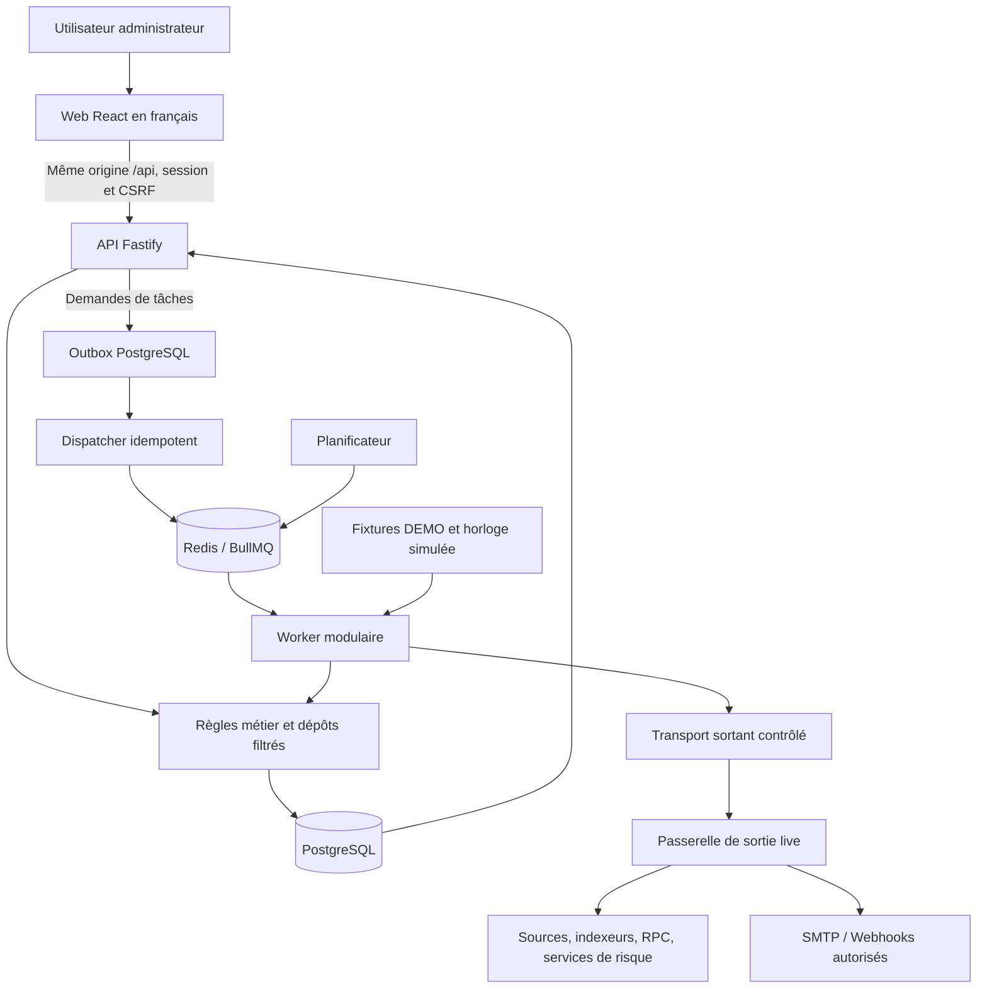
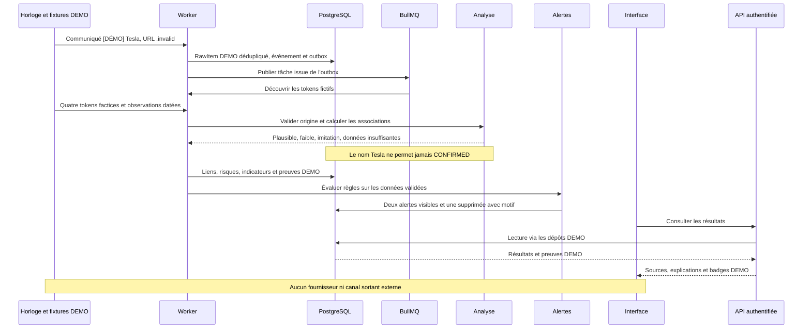
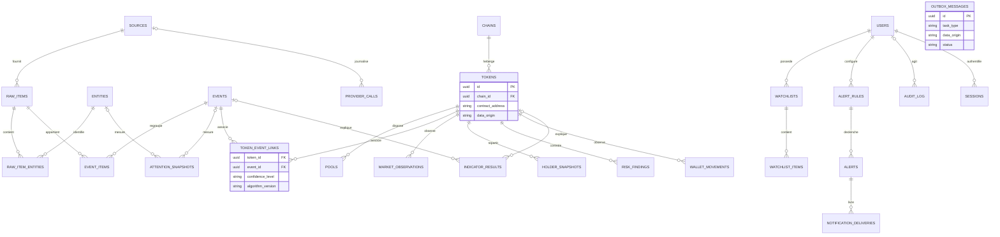

# Phase 2 — Architecture de MemeRadar

Statut : architecture validée pour passage à la phase 3, cadrage de phase 1 validé. Aucun composant décrit ici n'est encore implémenté. Le schéma physique, les contraintes et les migrations appartiennent à la phase 3 ; les contrats fournisseurs à la phase 4.

## 1. Choix techniques

Un monolithe modulaire partage les types et règles métier, mais s'exécute en processus distincts : API, worker/planificateur et serveur web. PostgreSQL constitue la source de vérité ; Redis porte les files, limites de débit et caches temporaires. La perte de Redis ne doit pas supprimer les données métier ou les notifications enregistrées.

| Élément | Choix | Justification et alternative |
|---|---|---|
| Langage/runtime | TypeScript strict, Node LTS maintenu à épingler en phase 5 | Contrats partagés ; Python/FastAPI ajouterait une seconde chaîne de types |
| API | Fastify, schémas Zod aux frontières | Validation explicite ; NestJS ajoute un cadre plus imposant |
| Interface | React, Vite, Tailwind, TanStack Query, Recharts | Application privée sans besoin de SEO ; Next.js ajouterait du rendu serveur sans nécessité établie |
| Persistance | PostgreSQL 16, pg_trgm, Drizzle et migrations SQL versionnées | Intégrité relationnelle, similarité textuelle ; Prisma reste une alternative |
| Asynchrone | Redis et BullMQ | Retries et concurrence contrôlés ; pas de broker supplémentaire en V1 |
| Tests | Vitest, fast-check, fixtures HTTP, Playwright, intégration Postgres/Redis | Règles pures et parcours reproductibles ; tests fournisseurs sans réseau réel |
| Exploitation | Docker Compose, logs JSON pino | Instance privée simple ; orchestration distribuée hors besoin initial |

Les versions exactes et compatibilités sont vérifiées au moment de l'installation. Pas de TimescaleDB initialement : index et rétention suffisent au petit corpus visé ; le partitionnement sera évalué avec les mesures de volumétrie.

## 2. Composants et frontières de confiance



La passerelle de sortie n'existe que dans le profil live. Le diagramme représente des responsabilités, pas nécessairement un conteneur par boîte : règles, dépôts et dispatcher sont des modules de l'API/worker. La notification interne est une écriture PostgreSQL ; aucune passerelle n'est nécessaire pour la consulter.

Le navigateur ne contacte aucun fournisseur : pas de clé API côté client, police/image/script tiers ou télémétrie distante. Les liens de sources live s'ouvrent uniquement sur action explicite avec les attributs de sécurité requis. Les URLs .invalid de démo restent affichables/copiables mais leur navigation externe est désactivée.

## 3. Organisation et dépendances

```text
apps/api/              routes, authentification, composition des services
apps/worker/           consommateurs BullMQ, planification, dispatcher outbox
apps/web/              vues, navigation, composants et état distant
packages/core/         identités, types et invariants métier, horloge injectable
packages/shared/       config, erreurs, logs, transport HTTP contrôlé
packages/connectors/   RSS/Atom, actualités, API sociales optionnelles
packages/chain/        découverte, adresses, lecture RPC et adaptateurs DEX
packages/analysis/     associations, marché, risques, attention et indicateurs
packages/alerts/       règles, suppression et préparation des notifications
packages/db/           schéma Drizzle, migrations et dépôts
seeds/demo/            scénarios fictifs et rejeu déterministe
tests/                 unit, integration, contract, fixtures, e2e
```

`core` ne dépend ni du réseau, ni d'un framework, ni de la base. Les algorithmes `analysis` et `alerts` consomment des objets validés et une horloge, sans accès direct aux fournisseurs. Les interfaces de stockage et de collecte sont injectées par les applications ; `db` implémente les dépôts. `connectors` et `chain` utilisent exclusivement le transport contrôlé de `shared`. Aucun package métier n'importe les applications ; le frontend n'importe ni `db`, ni les clients fournisseurs, ni la configuration serveur.

## 4. Flux de données et traçabilité

```mermaid
flowchart LR
  Source[Source autorisée ou fixture] --> Validate[Validation du contrat et origine]
  Validate --> Raw[RawItem normalisé et provenance]
  Raw --> Dedup[Déduplication exacte et approchée]
  Dedup --> Entities[Extraction et regroupement]
  Entities --> Event[Événement et attention]
  Event --> Discovery[Découverte de tokens]
  Discovery --> Identity[Validation chaîne et adresse]
  Identity --> Link[Association et contre-indications]
  Identity --> Enrich[Marché et contrôles de risque]
  Link --> Indicators[Cinq indicateurs versionnés]
  Enrich --> Indicators
  Event --> Indicators
  Indicators --> Rules[Règles et suppression]
  Rules --> Alert[Alerte persistée et outbox]
  Alert --> UI[Interface et notification interne]
  Alert --> Delivery[Canal externe explicitement activé en live]
```



Chaque résultat conserve son origine DEMO/REAL, son sujet, ses sources, la date d'observation, la date de collecte/calcul et la version de règle. Les faits observés, transformations calculées et hypothèses interprétées sont explicitement distingués dans les objets métier, les réponses et l'interface. Une interprétation référence ses observations ; elle ne les remplace pas.

Les extraits bruts sont limités et expirables. Un résultat dont la preuve a expiré reste marqué comme tel ; aucune source supprimée n'est silencieusement reconstituée. Les timestamps sont UTC ; les montants sont des chaînes décimales exactes dans l'API et NUMERIC en base, les quantités brutes des entiers arbitraires. Une absence est `null` avec motif, jamais zéro implicite.

## 5. Séquence du scénario Tesla fictif



Les métriques sont intégralement fictives ; ce scénario ne décrit pas les activités réelles de Tesla.

## 6. Modèle relationnel conceptuel



Ce diagramme couvre les familles requises et les ajouts opérationnels ; il ne remplace pas le SQL de phase 3. Un snapshot d'attention vise exactement un événement ou une entité. Un résultat d'indicateur vise exactement un événement ou un token : préférer des clés étrangères explicites et une contrainte d'exclusivité à un identifiant polymorphe non vérifiable. Les items de watchlist sont des expressions validées, pas nécessairement des liens vers une entité existante.

Chaque enregistrement reçoit une origine non nulle et indexée, y compris liaisons, configuration, audit et tâches. Les références entre données d'origines différentes sont interdites par des contraintes incluant l'origine, pas seulement par une convention applicative. Les données de configuration nécessaires aux deux modes sont créées séparément. L'unicité token porte sur origine, chaîne et adresse ; l'unicité RawItem sur origine, source et identifiant externe. Les contraintes exactes et les index temporels seront livrés en phase 3.

Les preuves officielles doivent enregistrer chaîne, adresse exacte normalisée, source officielle et publication. Leur absence rend CONFIRMED inaccessible. Le document de phase 3 précisera la conservation des observations et de leurs relations de provenance.

## 7. Séparation démo et live

- Un processus démarre dans un seul mode immuable ; l'interface affiche ce mode en lecture seule. Changer de mode implique un redémarrage, pas un paramètre de requête.
- Bases et namespaces Redis distincts par mode ; origine filtrée systématiquement dans les dépôts. L'API ne permet jamais au client de choisir arbitrairement l'origine.
- En démo, le transport fournisseur échoue avant toute résolution DNS. Les adaptateurs de fixtures n'utilisent aucun client réseau.
- Le profil Compose démo place les services sur un réseau interne sans passerelle de sortie, expose seulement l'interface locale et désactive tous les transports de notification externes. Le profil live ajoute une sortie filtrée pour le worker. Ces propriétés feront l'objet de vérifications effectives lors de la livraison Compose.
- Le navigateur démo charge uniquement des ressources locales et n'effectue que des requêtes même origine ; la CSP interdit les connexions et ressources externes. Les liens fictifs ne déclenchent pas de résolution externe.
- Les migrations et seeds sont idempotents et protégés contre une cible live ; un rejeu utilise une horloge injectée, jamais une modification de l'horloge système.

## 8. Cohérence, jobs et reprises

La livraison des tâches est au moins une fois. Une transaction PostgreSQL écrit l'état métier et son message outbox ; le dispatcher publie avec un identifiant stable. Un crash entre publication et marquage peut republier : le consommateur vérifie une clé d'idempotence et applique des upserts/contraintes uniques. Aucun composant ne revendique une livraison exactement une fois.

Files logiques : ingestion, découverte, enrichissement, analyse, alertes et notifications. Les jobs ne contiennent que identifiants, origine, version et contexte de corrélation, jamais de secret. Fenêtres de temps et curseurs sont persistés. Les appels externes ont timeout, retries bornés avec gigue et Retry-After, limiteur partagé Redis et coupe-circuit par fournisseur. Les erreurs d'authentification/validation ne sont pas réessayées aveuglément. Les échecs définitifs sont consultables et peuvent être rejoués après correction.

Les tâches indépendantes continuent en cas de panne fournisseur. Redis indisponible bloque la collecte planifiée et laisse l'outbox en attente ; l'API de consultation peut rester disponible avec état dégradé. PostgreSQL indisponible interdit les écritures et rend `/ready` non prêt. Les caches ne font jamais autorité pour l'origine ou l'authentification.

L'évaluation d'alertes sérialise l'état règle/sujet pour éviter les doublons concurrents. L'alerte et sa raison de suppression sont persistées avant livraison. Les notifications externes peuvent être livrées plus d'une fois après un timeout ambigu : identifiant stable et clé d'idempotence lorsque le canal le permet ; pas de garantie universelle d'envoi unique. Les heures silencieuses utilisent le fuseau IANA configuré, y compris les changements d'heure.

## 9. API et interface

Routes prévues : `/api/events`, `/api/tokens`, `/api/alerts`, `/api/alert-rules`, `/api/sources`, `/api/watchlists`, `/api/settings`, plus authentification et fiches détaillées. Pagination bornée par curseur, filtres validés et reflétés dans l'URL, dates ISO 8601 UTC, erreurs structurées avec code et identifiant de corrélation. Les contrats exacts seront figés en phase 12.

Chaque métrique inclut valeur nullable, unité, fournisseur, observed_at, fetched_at et drapeaux de qualité. Les cinq indicateurs exposent inputs_used, factors, missing_inputs, algorithm_version et computed_at. Aucun indicateur manquant n'est traduit en niveau faible.

Les six vues présentent les états chargement/vide/erreur/partiel/ancien. Les fiches affichent les preuves, contre-indications, adresse complète et chronologie ; les risques utilisent texte et icône. Une bannière permanente signale la démo. L'avertissement financier exact du cahier des charges figure en pied de page et en tête de fiche token. Le polling modéré suffit en V1 ; SSE est différé tant qu'un besoin mesuré ne le justifie pas.

## 10. Sécurité et exploitation

Authentification administrateur par mot de passe haché Argon2id, sessions opaques stockées côté serveur, cookie HttpOnly/SameSite et Secure sous HTTPS ; protection CSRF sur les mutations, rotation de session et limitation des tentatives. L'initialisation du compte ne fournit aucun mot de passe universel. La procédure démo locale et la création du compte seront testées au socle ; le live refuse une configuration d'authentification absente.

Même origine pour web/API, CORS fermé par défaut. Seuls web et ses routes API sont exposés ; PostgreSQL/Redis restent internes. Reverse proxy TLS obligatoire pour accès distant live. Conteneurs non root, CSP stricte, contenus externes traités comme texte hostile, aucune image distante sans proxy contrôlé.

Les appels HTTP live valident schéma, destination et port, résolvent les adresses, refusent loopback, réseaux privés, link-local, métadonnées et variantes IPv6. La connexion est liée à l'adresse vérifiée pour résister au rebinding ; chaque redirection est revalidée avec nombre de sauts borné. La couche de sortie renforce ces règles. Les endpoints internes DB/Redis sont configurés séparément et ne passent pas par un fetch utilisateur. SMTP utilise un adaptateur propre, TLS vérifié et destination configurée, jamais une URL fournie par une source.

Secrets injectés au runtime, expurgés des logs et exclus des jobs/réponses. Aucun portefeuille, primitive de signature ni envoi de transaction. Les RPC utilisent une liste d'opérations de lecture ; aucune construction de transaction signée. Les simulations éventuelles restent non signées et n'apportent aucune garantie sur une vente réelle.

`/health` indique la vie du processus sans exposer de configuration ; `/ready` vérifie schéma et dépendances nécessaires au rôle, avec réponse publique minimale. Logs JSON corrélés par requête/job, métriques facultatives sans identifiant personnel. Surveiller retard de collecte, âge de l'outbox, jobs échoués, quotas, données anciennes et notifications bloquées.

Sauvegarde PostgreSQL et test de restauration avant usage live ; rétention/purge des extraits et journaux selon la politique configurée. Redis est reconstructible depuis les tâches métier/outbox et les curseurs, sous réserve du rejeu idempotent. Arrêt gracieux : cesser la prise de jobs puis terminer ou rendre reprenables les jobs en cours.

## 11. Validation prévue

| Niveau | Preuve attendue |
|---|---|
| Domaine | Vitest et propriétés : identité, associations, déduplication, précision, indicateurs et alertes ; couverture ≥ 80 % core/analysis/alerts |
| Adaptateurs | Fixtures locales validées par schéma, timeout/retries/quota/circuit, secrets masqués et SSRF |
| Persistance/files | Postgres/Redis de test : contraintes d'origine, rollback, outbox, crash/reprise, concurrence et isolation des modes |
| API | Authentification, autorisation, CSRF, limites, contrats, filtres et erreurs |
| Interface | Playwright : trois scénarios, parcours Tesla, explications, avertissements, clavier, thèmes et états dégradés |
| Déploiement | Compose démo sans clé, redémarrage, santé effective, réseau externe bloqué et aucune requête tierce navigateur |
| Sécurité statique | Détecter capacités de signature, secrets accidentels et termes promotionnels dans le code livré ; ne pas confondre les exemples interdits de la documentation avec des capacités exécutables |

Les tests applicatifs n'utilisent aucun fournisseur réel ; les requêtes de test visent seulement les services locaux du banc d'essai. Les résultats seront rapportés à leur exécution, pas déduits de ce document.

## 12. Prochaine étape

Après validation de cette architecture : livrer en phase 3 le modèle physique complet, contraintes d'origine et de provenance, index, migrations et stratégie de rétention. Les détails non vérifiables sans sélection de fournisseurs restent explicitement réservés à la phase 4. Aucun besoin de secret ou d'abonnement pour approuver cette architecture.
